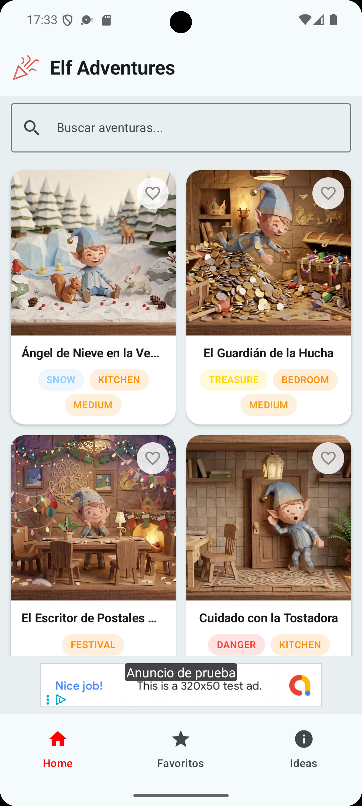
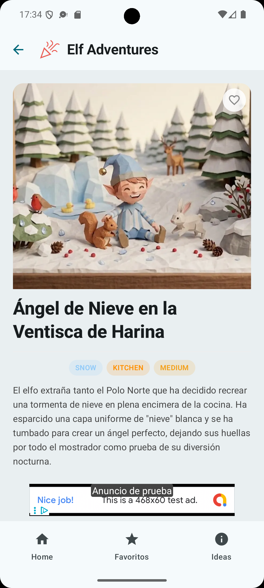
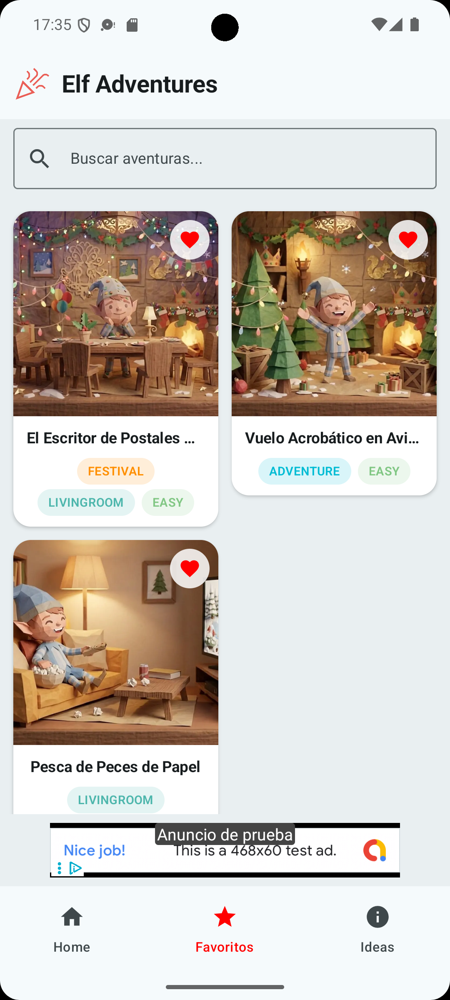
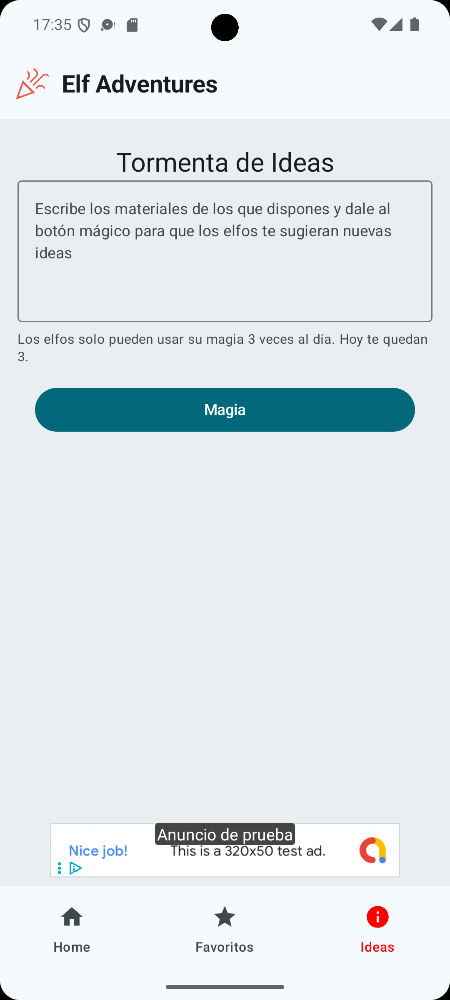

# Elfos Navideños

Aplicación Android nativa para descubrir ideas de travesuras y escenas navideñas con elfos. La app permite explorar aventuras, consultar el detalle de cada idea, guardar favoritas y generar nuevas propuestas con IA a partir de los materiales disponibles en casa.

Este proyecto es el trabajo final del curso [AI Expert de DevExpert](https://devexpert.io/cursos/expert/ai). Gracias a lo aprendido en las clases, he podido construir la aplicación apoyándome en la IA durante el desarrollo y escribiendo muy poco código manualmente.

## Capturas

<p align="center">
  
  
  
  
</p>

## Funcionalidades

- Listado de aventuras navideñas para preparar escenas con elfos.
- Buscador de ideas por texto.
- Pantalla de detalle con descripción, materiales y tiempo estimado.
- Sistema de favoritos persistente.
- Generación de nuevas ideas mediante Firebase AI/Gemini.
- Límite diario de usos de la función de IA.
- Soporte multiidioma con recursos en español e inglés.
- Banners publicitarios con Google Mobile Ads.

## Stack Técnico

- Kotlin.
- Jetpack Compose.
- Material 3.
- Navigation Compose.
- Hilt para inyección de dependencias.
- Room para persistencia local.
- DataStore para preferencias.
- Firebase AI/Gemini para generación de ideas.
- Google Mobile Ads.
- Coil para carga de imágenes.
- Gradle KTS y Version Catalog.

## Arquitectura

El proyecto sigue Clean Architecture, separando responsabilidades en tres capas principales:

- `domain`: modelos de negocio, contratos de repositorio y casos de uso.
- `data`: base de datos Room, DAO, entidades, mappers, DataStore y repositorios.
- `ui`: pantallas Compose, ViewModels, estado, navegación, componentes comunes y tema visual.

La estructura general mantiene la dependencia hacia el dominio:

```text
UI -> Domain <- Data
```

## Estructura Del Proyecto

```text
app/src/main/java/com/calleserpis/elfonavidenyo
├── common
├── data
├── di
├── domain
└── ui
```

Cada pantalla sigue el patrón `Screen`, `ViewModel`, `State` y `Event` cuando aplica, manteniendo la UI separada de la lógica de presentación.

## Configuración Local

El archivo `app/google-services.json` no está incluido en el repositorio por seguridad. Para ejecutar las funciones conectadas con Firebase AI es necesario añadir localmente ese archivo dentro del módulo `app`.

También se excluye `local.properties`, ya que contiene rutas locales del SDK de Android.

## Comandos Útiles

Compilar la app en debug:

```bash
./gradlew assembleDebug
```

Ejecutar tests unitarios:

```bash
./gradlew test
```

Limpiar el proyecto:

```bash
./gradlew clean
```

## Nota Sobre El Desarrollo Con IA

La aplicación se ha desarrollado como ejercicio práctico de uso de IA aplicada al desarrollo Android. El objetivo no era solo crear una app funcional, sino validar un flujo de trabajo donde la IA ayuda a diseñar, implementar, revisar y evolucionar el proyecto con una intervención manual mínima.
